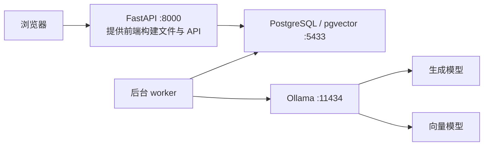

# 食日记 · 高血压饮食推荐系统

基于 React、FastAPI、PostgreSQL/pgvector 和 Ollama 的本地饮食推荐应用，部署在 NVIDIA Spark 上。支持中、英、日三种语言、用户档案、三餐推荐、知识库引用、推荐历史和管理员后台。

**这份文档重点说明：Spark 重启后如何恢复使用，搬到别的地方后如何连接，以及前端、后端和模型服务分别怎么启动。**

当前机器已经完成数据库初始化、模型准备、依赖安装和前端构建。日常开机**不用重新安装依赖、下载模型、导入知识库或创建管理员**。

文档核对日期：**2026-10-11，Asia/Tokyo**。机器信息为本次核对结果，后续升级以实际配置为准。

## 目录

1. [重启后快速恢复使用](#1-重启后快速恢复使用)
2. [部署结构与端口](#2-部署结构与端口)
3. [把 Spark 带到别的地方](#3-把-spark-带到别的地方)
4. [前端启动与更新](#4-前端启动与更新)
5. [后端 API 与 worker](#5-后端-api-与-worker)
6. [Ollama 与两个模型](#6-ollama-与两个模型)
7. [检查服务是否真的正常](#7-检查服务是否真的正常)
8. [账号配置与数据位置](#8-账号配置与数据位置)
9. [常见故障排查](#9-常见故障排查)
10. [关机备份与迁移](#10-关机备份与迁移)
11. [开发验证与相关资料](#11-开发验证与相关资料)

---

## 1. 重启后快速恢复使用

本节命令都在 **Spark 的终端**执行。可以直接在 Spark 上打开终端，也可以从另一台电脑 SSH 登录后执行。

### 第一步：进入项目，启动数据库

```bash
cd /home/aitd/hypertension-diet

# Docker 已运行时，再执行 start 也可以。
sudo systemctl start docker

# 启动本项目的数据库，复用原数据卷。
sudo docker compose up -d db

# 等待 db 状态变成 healthy。
sudo docker compose ps

# 正常时应包含 accepting connections。
sudo docker compose exec -T db pg_isready -U diet_app -d hypertension_diet
```

如果数据库还在启动，稍后再次执行检查命令。

**sudo 提示输入密码时，使用 Spark 上 `aitd` 用户的系统登录密码，不是网页 `admin` 账号密码。**

### 第二步：检查模型服务

```bash
curl --fail --silent --show-error --max-time 10 \
  http://127.0.0.1:11434/api/version
```

有版本 JSON 返回，说明 Ollama HTTP 服务已启动，继续第三步。

如果无法连接，查看并启动原有 Ollama 容器：

```bash
# -a 同时显示已经停止的容器。
sudo docker ps -a --format 'table {{.Names}}\t{{.Image}}\t{{.Status}}\t{{.Ports}}'

# 根据上一条输出输入真实容器名。
read -r -p "请输入 Ollama 容器名： " DIET_OLLAMA_CONTAINER

if [ -n "$DIET_OLLAMA_CONTAINER" ]; then
  sudo docker start "$DIET_OLLAMA_CONTAINER"
fi

curl --fail --silent --show-error --max-time 10 \
  http://127.0.0.1:11434/api/version
```

本机当前用户没有直接访问 Docker socket 的权限，因此这里使用 `sudo docker`。编写文档时已验证 Ollama 接口可用，但无法直接读取其实际容器名、挂载目录和重启策略，**不要假定容器一定叫 `ollama`**。

找不到原容器时，先看[模型服务说明](#6-ollama-与两个模型)，核对原部署和模型存储位置。

### 第三步：启动应用

```bash
cd /home/aitd/hypertension-diet
backend/.venv/bin/python -m scripts.service start
backend/.venv/bin/python -m scripts.service status

curl --fail --silent --show-error --max-time 10 \
  http://127.0.0.1:8000/api/health
```

预期进程状态：

```text
api: running
worker: running
```

健康接口应返回：

```json
{"status":"alive"}
```

如果提示 `Frontend not built` 或 `Build frontend first`，参阅[前端构建](#4-前端启动与更新)。

### 第四步：打开网页

在 **Spark 本机浏览器**打开：

```text
http://127.0.0.1:8000
http://127.0.0.1:8000/chat
```

管理员账号：`admin`。初始登录信息文件：

```text
/home/aitd/hypertension-diet/data/private/admin-account.csv
```

后来改过密码时，以修改后的密码为准，初始 CSV 不会自动更新。README 不保存实际密码。

**手机、平板、笔记本连接到与 Spark 互通的局域网后，直接访问 `http://Spark当前IP:8000/chat`，详见第 3 节。其他设备中的 `127.0.0.1` 指的是设备自己，不能用来直接访问 Spark。** 启动脚本会显示当前可用的网卡地址；SSH 隧道仍可作为电脑的另一种访问方式。

## 2. 部署结构与端口

### 2.1 本机信息

| 项目 | 本次核对结果 |
|---|---|
| 机器名 / 用户 | `spark-af23` / `aitd` |
| 项目目录 | `/home/aitd/hypertension-diet` |
| 架构 / GPU | `aarch64` / NVIDIA GB10 |
| NVIDIA 驱动 | `580.178.04` |
| Python | 项目虚拟环境使用 Python `3.12.3` |
| Node.js | `22.23.3`，位于 `.tools/node/current/bin` |
| Ollama | 接口返回版本 `0.40.0` |
| 数据库 | PostgreSQL 16，pgvector `0.8.2` |
| 生成模型 | `qwen3.6:35b-a3b` |
| 向量模型 | `qwen3-embedding:4b-q4_K_M`，维度 `2560` |

### 2.2 需要运行哪些部分

| 部分 | 作用 | 日常启动方式 | 地址 / 端口 |
|---|---|---|---|
| 前端构建文件 | 登录、聊天、推荐和管理页面 | 由 API 提供，不单独运行 Node | 与 API 共用 `8000` |
| FastAPI | 登录、资料、菜谱、聊天任务接口 | `scripts.service start` | 监听 `0.0.0.0:8000`，使用 Spark 当前 IP 访问 |
| 后台 worker | 执行排队的聊天、推荐和知识库导入 | 同一个 `scripts.service start` | 无独立 HTTP 端口 |
| PostgreSQL / pgvector | 用户、菜谱、历史、食品数据与知识向量 | `sudo docker compose up -d db` | `127.0.0.1:5433` |
| Ollama | 运行生成模型与向量模型 | 启动原有 Ollama 容器 | `127.0.0.1:11434` |
| Vite 开发服务器 | 修改前端时提供热更新 | 仅开发时 `npm run dev` | 通常 `127.0.0.1:5173` |

数据库容器内使用 `5432`，映射到 Spark 宿主机的 **5433**。不要误连宿主机上其他 PostgreSQL 的 5432。



Web API 监听所有 IPv4 网卡（`0.0.0.0:8000`），同时提供页面和接口。`0.0.0.0` 是监听配置，不是供其他设备访问的网址。数据库和 Ollama 仍只绑定本机回环地址。项目 Compose **只定义了数据库**，`docker compose up -d` 不会同时启动 API、worker 和 Ollama。

### 2.3 关终端和重启机器的区别

- `scripts.service start` 启动的 API、worker 脱离终端运行；关闭启动终端后仍能工作。
- 重启 Spark 会终止这些进程。**目前没有给 API、worker 配置开机自启**，登录后需重新运行 `start`。
- Docker 服务本次检查为开机启用；数据库配置了 `restart: unless-stopped`。
- Ollama 是否自动恢复取决于其容器配置，需要按第 6 节检查。
- 手动停止过的容器，不能单凭 `unless-stopped` 假定下次开机一定恢复。按第 1 节检查、启动即可。

## 3. 把 Spark 带到别的地方

### 3.1 同一台 Spark，只是换了位置或网络

项目、数据库卷和模型文件都在 Spark 上。正常关机搬运后，通常只需要：

1. 接好电源和网络，正常开机。
2. 确认 Spark 在新网络中的 IP。
3. 按第 1 节检查数据库、Ollama，启动 API 和 worker。
4. 其他设备连接到与 Spark 互通的局域网，用浏览器打开 `http://新IP:8000/chat`，然后登录。

启动脚本没有写死家庭或实验室 IP。换网络后，Web 会接受新网卡地址上的连接，无需改代码、重新构建前端或修改模型配置。IP 变化后，旧网页地址或书签需要更新；新地址下重新登录即可。Spark 重启后仍需运行 `scripts.service start`，尚未配置应用开机自启。

**项目内部的 `127.0.0.1:5433` 和 `127.0.0.1:11434` 不需要因为换 Wi-Fi 而修改。** 这些连接发生在同一台 Spark 内。

依赖、Docker 镜像、模型权重、数据库和 `frontend/dist` 都已保存在本机时，日常使用可以不依赖互联网。重新下载依赖、镜像或模型时才需要联网。

### 3.2 在 Spark 上查询自己的局域网 IP

在 **Spark 终端**运行项目提供的命令：

```bash
cd /home/aitd/hypertension-diet
backend/.venv/bin/python -m scripts.lan
```

它读取本机已连接的有线/Wi-Fi 网卡，自动排除回环、Docker 和 VPN 虚拟网卡，不扫描其他设备，也不需要连接互联网。输出示例：

```text
Spark 本机：http://127.0.0.1:8000/chat
网卡：wlP9s9  IP：192.168.11.39  子网：192.168.11.0/24
同一局域网的设备打开：http://192.168.11.39:8000/chat
```

**示例 IP 是本次检查时的地址，搬到实验室后请重新执行命令，以当时的输出为准。** 同时连接有线和 Wi-Fi 时会列出多个地址，使用与访问设备所在网络互通的那个。`scripts.service start`、`restart` 和 `status` 也会显示这些地址；地址出现不代表服务一定已启动，应同时查看 `api: running`。

也可以使用系统命令查询：

```bash
hostname
hostname -I
ip -brief -4 address
```

选择当前有线网或 Wi-Fi 网卡的局域网地址，不要选 `127.0.0.1`、`docker0` 或 Docker 网桥地址。也可从路由器设备列表寻找 `spark-af23`。

`spark-af23.local` 能否解析取决于当前网络是否支持 mDNS，不能保证酒店、校园网和热点都支持。确定 IP 后用 IP 连接更便于排查。

### 3.3 从笔记本登录 Spark

以下在 **笔记本终端**执行，示例 IP 必须替换：

```bash
SPARK_IP="192.168.1.50"  # 替换成 Spark 实际 IP
ssh "aitd@$SPARK_IP"
```

登录成功后，终端就在 Spark 上，可以执行第 1 节命令。

无法连接时，先确认两台设备网络互通。访客 Wi-Fi 可能隔离设备；都能上网不等于设备之间能相互访问。

在 Spark 本机检查 SSH：

```bash
systemctl status ssh.socket ssh --no-pager
```

本次检查为 `ssh.socket` 已启用、SSH 服务正在运行。`ssh.service` 单独显示 `disabled` 不能说明 SSH 不会启动，还要看 socket 状态。

### 3.4 手机、平板和电脑直接通过局域网访问

1. 在 Spark 上按第 1 节启动数据库、模型、API 和 worker。若是首次应用本次监听配置，执行：

   ```bash
   cd /home/aitd/hypertension-diet
   backend/.venv/bin/python -m scripts.service restart
   backend/.venv/bin/python -m scripts.lan
   ```

2. 手机、平板或电脑接入与 Spark 互通的局域网（通常为同一路由器下的 Wi-Fi 或网线）。
3. 在其他设备的浏览器中输入上一步输出的网址。例如当前地址是：

   ```text
   http://192.168.11.39:8000/chat
   ```

4. 使用原有网页账号登录。管理员账号登录后显示管理菜单，普通账号仍只有普通权限。无需在手机上安装模型、数据库或开发环境。

页面与 `/api` 使用同一地址，登录来源校验跟随浏览器当前地址，不需要维护固定 IP 白名单。图片、推荐、知识库请求也由 Spark 的 8000 端口提供；其他设备不需要连接数据库 5433 或模型 11434。

#### 无法打开时怎么检查

在 Spark 上检查：

```bash
backend/.venv/bin/python -m scripts.service status
backend/.venv/bin/python -m scripts.lan
ss -ltn '( sport = :8000 )'
curl --fail --max-time 10 http://127.0.0.1:8000/api/health
```

监听结果应包含 `0.0.0.0:8000`，健康接口应返回 `{"status":"alive"}`。若仍显示 `127.0.0.1:8000`，先执行 `scripts.service restart`。

再在另一台电脑上检查（替换为最新 IP）：

```bash
curl --fail --max-time 10 http://192.168.11.39:8000/api/health
```

- Spark 本机正常，但其他设备超时：检查地址是否已变化、两台设备是否网络互通、实验室或访客 Wi-Fi 是否开启设备隔离。
- 能看到登录页，说明网页连接已经建立。换 IP 后需要重新登录；不能使用其他设备自己的 `localhost` 或 `127.0.0.1` 作为 Spark 地址。
- 检查 Spark 防火墙：`sudo ufw status verbose`。如果显示 `inactive`，无需添加 UFW 规则。如果已启用且没有允许 Web，可只放行当前局域网到 TCP 8000：

  ```bash
  # 将下面子网替换为 scripts.lan 输出的当前“子网”。
  sudo ufw allow from 192.168.11.0/24 to any port 8000 proto tcp
  sudo ufw status verbose
  ```

  换到实验室后，如果防火墙已启用且新子网不同，需要按新子网添加规则。不要为排查关闭整个防火墙。无管理员权限时联系实验室管理员。

当前提供的是局域网 HTTP 访问，适合受信任的网络；HTTP 不加密登录和业务数据。不要配置路由器公网端口转发。对外正式部署应另外配置 HTTPS。

### 3.5 电脑通过 SSH 隧道访问（可选）

另开一个 **笔记本终端**：

```bash
SPARK_IP="192.168.1.50"  # 替换成 Spark 实际 IP
ssh -N -o ExitOnForwardFailure=yes \
  -L 18000:127.0.0.1:8000 \
  "aitd@$SPARK_IP"
```

保持该终端运行，在笔记本浏览器打开：

```text
http://127.0.0.1:18000
http://127.0.0.1:18000/chat
```

连接路径：**笔记本 18000 → SSH → Spark 8000**。前端与 API 一起通过此地址访问，数据库和模型不需要单独转发。

- 终端不返回命令提示符是正常现象，`-N` 只建立隧道，不打开远程 shell。
- 关闭该终端或按 `Ctrl+C` 会关闭隧道，但不会停止 Spark 上的应用。
- Spark 重启、断网或 IP 变化后，要重新建立隧道。
- 笔记本的 18000 被占用时，可改用 `-L 18001:127.0.0.1:8000`，浏览器也改为 18001。
- SSH 隧道依赖 SSH 连接可用；如果网络完全隔离设备，隧道也无法绕过该隔离。

本文支持本机、局域网直接访问及 SSH 隧道访问。对公网提供服务还需要单独配置域名、HTTPS、代理、网络访问和备份策略。

## 4. 前端启动与更新

### 4.1 日常使用不用单独启动前端

前端源码在 `frontend/src/`，构建结果在 `frontend/dist/`。

运行 `backend/.venv/bin/python -m scripts.service start` 后，打开 8000 即可使用页面。无需 `npm run dev`，也无需长期运行 Node 进程。

### 4.2 修改前端后更新正式页面

在 Spark 项目根目录：

```bash
cd /home/aitd/hypertension-diet
export PATH="$PWD/.tools/node/current/bin:$PATH"

# 已安装 node_modules 时，直接构建。
npm --prefix frontend run build

# 确保 API 加载最新静态目录；同时也会重启 worker。
backend/.venv/bin/python -m scripts.service restart
```

然后刷新浏览器。8000 读取的是构建文件，单改 `frontend/src/` 不会自动更新它。

也可使用：

```bash
bash scripts/build_frontend.sh
```

这个脚本会执行 `npm ci`、生成初始插画并构建页面，适用于需要重新安装依赖的情况。**离线或只是日常重启，不应把重新安装依赖当作必需步骤。**

如果主动修改了新增菜谱示意图的生成逻辑，先运行：

```bash
backend/.venv/bin/python -m scripts.make_catalog_art
```

再构建前端。普通换图在管理页面直接上传即可，不需要重新生成插画。

### 4.3 开发模式：前端热更新

数据库、Ollama、API、worker 正常运行后，另开一个 Spark 终端：

```bash
cd /home/aitd/hypertension-diet
export PATH="$PWD/.tools/node/current/bin:$PATH"
npm --prefix frontend run dev -- --port 5173 --strictPort
```

在 Spark 浏览器打开 `http://127.0.0.1:5173`。

`frontend/vite.config.ts` 把 `/api` 请求代理到 `127.0.0.1:8000`。只启动 Vite，登录和推荐不会自行工作。

笔记本访问开发页面时，可另外建立隧道：

```bash
SPARK_IP="192.168.1.50"  # 替换成 Spark 实际 IP
ssh -N -o ExitOnForwardFailure=yes \
  -L 15173:127.0.0.1:5173 \
  "aitd@$SPARK_IP"
```

笔记本浏览器访问 `http://127.0.0.1:15173`。Vite 终端按 `Ctrl+C` 停止，不影响 8000 上已构建的页面。

## 5. 后端 API 与 worker

### 5.1 推荐使用服务脚本

在项目根目录执行：

| 目的 | 命令 |
|---|---|
| 启动 API 与 worker | `backend/.venv/bin/python -m scripts.service start` |
| 查看进程状态 | `backend/.venv/bin/python -m scripts.service status` |
| 重启 API 与 worker | `backend/.venv/bin/python -m scripts.service restart` |
| 停止 API 与 worker | `backend/.venv/bin/python -m scripts.service stop` |

脚本**不负责启停数据库、Ollama，不安装依赖、不构建前端、不导入数据**。

API 接收请求，worker 执行排队任务。网页能打开但聊天一直等待时，要同时检查 worker。

`status` 根据 PID 和进程信息判断是否运行，只能证明进程存在，不能证明数据库和模型推理正常。

### 5.2 查看日志

```bash
cd /home/aitd/hypertension-diet

tail -n 100 data/runtime/api.log
tail -n 100 data/runtime/worker.log

# 连续观察；Ctrl+C 只是退出日志查看。
tail -f data/runtime/api.log data/runtime/worker.log
```

| 文件 | 内容 |
|---|---|
| `data/runtime/api.pid` | API 进程编号 |
| `data/runtime/worker.pid` | worker 进程编号 |
| `data/runtime/api.log` | Web/API 日志 |
| `data/runtime/worker.log` | 聊天、推荐和知识库导入日志 |

脚本会检查 PID 对应的命令和工作目录。重启后看到旧 PID 文件，不必手工删除，直接用脚本检查和启动。

### 5.3 手动运行：仅用于开发排错

先停止脚本管理的进程，避免抢占端口和重复 worker：

```bash
cd /home/aitd/hypertension-diet
backend/.venv/bin/python -m scripts.service stop
```

Spark 终端 A：

```bash
cd /home/aitd/hypertension-diet
backend/.venv/bin/python -m uvicorn backend.main:app \
  --host 127.0.0.1 --port 8000 --reload
```

Spark 终端 B：

```bash
cd /home/aitd/hypertension-diet
backend/.venv/bin/python -m backend.app.worker
```

手动进程在各自终端按 `Ctrl+C` 结束，之后才恢复使用 `scripts.service start`。

手动启动没有写入服务脚本的 PID 文件，不能用脚本的 `status` 判断手动进程状态。正常使用无需这种模式。

## 6. Ollama 与两个模型

### 6.1 一个模型服务，两个模型

应用通过同一个 Ollama HTTP 服务调用：

- **生成模型** `qwen3.6:35b-a3b`：用于意图识别、回答生成等。
- **向量模型** `qwen3-embedding:4b-q4_K_M`：用于知识库检索和导入，输出维度 2560。

不需要分别启动两个 Ollama 服务。模型文件存在后，收到对应请求时由 Ollama 加载；首个请求可能包含加载时间。

本机未发现可直接使用的宿主机 `ollama` 命令，也未发现 `ollama.service`。当前沿用 Docker 中的模型服务，不要额外安装并启动一个抢占 11434 的宿主机服务。

### 6.2 查看模型状态

```bash
curl --fail --silent --show-error http://127.0.0.1:11434/api/version

curl --fail --silent --show-error http://127.0.0.1:11434/api/tags \
  | backend/.venv/bin/python -m json.tool

curl --fail --silent --show-error http://127.0.0.1:11434/api/ps \
  | backend/.venv/bin/python -m json.tool
```

- `/api/tags`：已有模型，应包含配置中的两个完整名称。
- `/api/ps`：当前已加载到内存中的模型。
- `/api/ps` 没有某个模型，不代表权重丢失，应先看 `/api/tags`。
- 列表正常不代表 CUDA 推理正常，第 7 节提供实际调用检查。

### 6.3 查看容器配置与日志

新开终端不会自动保留之前设置的 shell 变量，先确认容器名：

```bash
sudo docker ps -a --format 'table {{.Names}}\t{{.Image}}\t{{.Status}}'
read -r -p "请输入 Ollama 容器名： " DIET_OLLAMA_CONTAINER

# 查看镜像引用和重启策略，不输出完整环境变量。
sudo docker inspect \
  --format 'Image={{.Config.Image}} Restart={{.HostConfig.RestartPolicy.Name}}' \
  "$DIET_OLLAMA_CONTAINER"

# 查看模型的卷 / 宿主机挂载位置。
sudo docker inspect --format '{{json .Mounts}}' "$DIET_OLLAMA_CONTAINER"

# 查看 GPU 设备请求与运行时。
sudo docker inspect \
  --format 'Runtime={{.HostConfig.Runtime}} Devices={{json .HostConfig.DeviceRequests}}' \
  "$DIET_OLLAMA_CONTAINER"

sudo docker logs --tail 100 "$DIET_OLLAMA_CONTAINER"
```

需要重启时：

```bash
sudo docker restart "$DIET_OLLAMA_CONTAINER"
```

重启会中断正在执行的模型请求，尽量等当前聊天、导入完成后再操作。

希望模型容器跟随 Docker 恢复时，可在确认容器名后**自行选择**执行一次：

```bash
sudo docker update --restart unless-stopped "$DIET_OLLAMA_CONTAINER"
```

这不会为 API、worker 设置自启动。编写本文时没有替你修改系统自启动设置。

### 6.4 模型不见了

先检查是不是启动了另一个空容器、原模型卷没有挂载，或者模型名称拼写不一致。

```bash
sudo docker exec "$DIET_OLLAMA_CONTAINER" ollama list
```

**换地方或正常重启不需要 `ollama pull`。** 确实重建模型环境时，应恢复原权重、模型定义和容器配置，或者在联网情况下重新准备模型。

知识库关联模型实际 digest、维度和处理版本。相同模型标签重新拉取后，权重也可能变化，届时可能需要重建知识向量。不要通过随意换模型修复空检索结果。

本次读取的 digest：

```text
qwen3.6:35b-a3b
a7eb95c53bcf96b4bdd008d0fab4a5dac88047d9c1a7a9ab88ed453423fbd87c

qwen3-embedding:4b-q4_K_M
df5bd2e3c74cd8d069d21dc038f1b359fcdc9458fce1c99bd43c9eb1518ff907
```

## 7. 检查服务是否真的正常

### 7.1 快速检查

```bash
cd /home/aitd/hypertension-diet
backend/.venv/bin/python -m scripts.service status
curl --fail --silent --show-error http://127.0.0.1:8000/api/health
curl --fail --silent --show-error http://127.0.0.1:11434/api/version
sudo docker compose exec -T db pg_isready -U diet_app -d hypertension_diet
```

登录网页后，可在同一个浏览器访问：

```text
http://127.0.0.1:8000/api/readiness
http://127.0.0.1:8000/docs
```

经 SSH 隧道访问时，把 8000 换成笔记本的转发端口，例如 18000。

`/api/readiness` 要求登录，检查数据库和配置中的模型是否在列表内。`/api/health` 仅表示 API 能响应，都不能替代实际推理检查。

### 7.2 检查数据库读取

以下只读，不导入或删除数据：

```bash
cd /home/aitd/hypertension-diet
backend/.venv/bin/python - <<'PY'
from backend.app.db import connect

with connect() as c:
    for table in ("foods", "app_ingredients", "app_recipes", "kb_documents", "kb_chunks"):
        row = c.execute("SELECT count(*) AS n FROM " + table).fetchone()
        print(table, row["n"])
PY
```

本次检查：食品资料 2477 条、已接入食材 49 种、菜谱 184 道、知识文档 5 份、片段 1337 条。后台新增或导入后会变化，不能仅凭数量不同判断故障。

### 7.3 实际测试生成模型与向量模型

下面会真正加载、调用两个模型，不写入用户聊天或推荐历史。首次执行可能较慢，并会占用 GPU 资源。

```bash
cd /home/aitd/hypertension-diet
backend/.venv/bin/python - <<'PY'
import httpx
from backend.config import settings

with httpx.Client(timeout=settings.timeout_seconds) as client:
    result = client.post(
        settings.ollama_base_url + "/api/generate",
        json={
            "model": settings.llm_model,
            "prompt": '只返回 JSON：{"status":"ok"}',
            "format": "json",
            "think": False,
            "stream": False,
            "options": {
                "num_batch": settings.llm_num_batch,
                "num_ctx": 6144,
                "num_predict": 64,
            },
        },
    )
    result.raise_for_status()
    text = result.json().get("response", "").strip()
    if not text:
        raise RuntimeError("生成模型没有返回正文，请检查模型日志")
    print("生成模型返回：", text)

    result = client.post(
        settings.ollama_base_url + "/api/embed",
        json={
            "model": settings.embedding_model,
            "input": ["饮食知识检索连接测试"],
            "truncate": False,
        },
    )
    result.raise_for_status()
    vectors = result.json().get("embeddings", [])
    if len(vectors) != 1 or len(vectors[0]) != settings.embedding_dim:
        raise RuntimeError("向量数量或维度与项目配置不一致")
    print("向量模型通过，维度：", len(vectors[0]))
PY
```

最后用已确认资料的账号在网页提交一次饮食聊天，确认任务完成并能打开引用来源，覆盖 API、worker、数据库、检索和模型的实际协作。

当前聊天入口是 `/api/diet-chat/messages`。旧 `/api/chat`、`/api/embed` 已停用；上述向量测试调用的是 **Ollama 的 11434 端口**，不是应用的 8000 端口。

## 8. 账号配置与数据位置

### 8.1 三份配置文件

| 文件 | 用途 | 日常重启是否重写 |
|---|---|---|
| 根目录 `.env` | Compose 的 `POSTGRES_PASSWORD` | 不需要 |
| `backend/.env` | 模型地址、名称、维度、数据库维护连接 | 不需要 |
| `backend/app.env` | 运行账号 `diet_web` 的数据库连接与 Cookie 配置 | 不需要 |

当前模型配置：

```dotenv
OLLAMA_BASE_URL=http://127.0.0.1:11434
LLM_MODEL=qwen3.6:35b-a3b
EMBEDDING_MODEL=qwen3-embedding:4b-q4_K_M
EMBEDDING_DIM=2560
OLLAMA_TIMEOUT_SECONDS=300
LLM_NUM_BATCH=64
```

数据库连接含密码，本文不展示实际值。三个 `.env.example` 文件只是模板，**不要在正常重启时用模板覆盖已经配置的文件**。

修改后端配置后重启 API、worker。进程环境变量可能覆盖文件值；手工 `export` 过旧配置时，注意当前终端环境。

已有 PostgreSQL 数据卷时，只改 Compose 的 `POSTGRES_PASSWORD` 不会自动修改库内角色密码。连接失败应先核对配置与实际密码。

### 8.2 账号维护

| 内容 | 位置 / 操作 |
|---|---|
| 管理员初始信息 | `data/private/admin-account.csv` |
| 原普通账号初始信息 | `data/private/local-accounts.csv` |
| 新增用户 | 管理员登录 → 用户管理 |
| 管理员重置密码 | 用户管理 → 重置密码，新密码只展示一次 |
| 用户自己改密码 | 用户信息中的修改密码功能 |
| 命令行重置记录 | `data/private/password-resets.csv`，只记录通过维护脚本进行的重置 |

初始文件不反映后续改密。数据库保存密码哈希，不能直接从数据库取回明文密码。

### 8.3 重要目录

```text
hypertension-diet/
├── README.md
├── compose.yaml                   # 数据库容器
├── .env                           # Compose 私有配置
├── backend/
│   ├── .venv/                     # Python 环境
│   ├── .env                       # 后端私有配置
│   ├── app.env                    # 应用数据库账号配置
│   ├── main.py                    # API 入口
│   ├── app/worker.py              # 后台任务进程
│   └── migrations/                # 数据库迁移
├── frontend/
│   ├── src/                       # React 源码
│   ├── public/recipe-art/         # SVG 示意图及三语版本
│   └── dist/                      # 8000 端口提供的构建结果
├── data/
│   ├── private/                   # 私有账号文件
│   ├── runtime/                   # PID、日志
│   ├── uploads/recipes/           # 上传的 WebP 图片
│   ├── uploads/knowledge/         # 上传的 PDF
│   ├── originals/                 # 原件快照
│   ├── extracted/                 # 提取文本
│   ├── repair/                    # OCR / 字体修复产物
│   ├── food2020/                  # 食品成分源文件
│   └── backups/                   # 数据库备份
├── .tools/node/current/           # 本机 Node
├── scripts/                       # 启停、构建、备份、验证
└── docs/                          # 管理说明、契约、验收记录
```

未使用上传功能时，`data/uploads/` 及其子目录可能还没创建，这是正常的。

**数据库实际存储在 Docker 命名卷 `hypertension-diet_diet_pgdata`，不等同于项目中的 `data/` 目录。** 模型权重位置通过 Ollama 容器挂载信息确认。

| 数据表 | 内容 |
|---|---|
| `foods` / `food_values` | 食品基础资料与营养值 |
| `app_ingredients` | 推荐食材、语言名称、价格、过敏标签 |
| `app_recipes` | 菜谱、食材克数、做法；图片地址在 `data.image` |
| `kb_documents` / `kb_pages` / `kb_chunks` | 知识文档、页面、向量片段 |
| `app_users` / `app_user_roles` | 用户、角色关系 |
| `app_jobs` | 聊天、推荐等排队任务 |

上传图片会保存 WebP 并更新 `app_recipes.data.image`。旧图片保留供历史使用。SVG 仍用于未替换图片的菜谱。

## 9. 常见故障排查

| 现象 | 优先检查 |
|---|---|
| 网页打不开 | API、8000 监听、SSH 隧道 |
| Spark 能打开，笔记本打不开 | 新 IP、转发端口、网络隔离；笔记本自己的 8000 不是 Spark |
| 网页正常，聊天一直排队 | worker、知识库导入是否占用队列、`worker.log` |
| health 正常，登录失败或 503 | 数据库、`backend/app.env` 的连接 |
| 11434 Connection refused | Ollama 容器及端口映射 |
| 模型列表存在但不能生成 | 实际推理检查、CUDA 日志 |
| 找不到模型 | 完整模型名、原模型卷、是否启动了空容器 |
| 有菜单但没有知识说明 | 向量模型、digest 兼容性、知识文档是否启用 |
| 修改前端没有变化 | 是否构建 `frontend/dist`，是否刷新浏览器 |
| 图片不显示 | 登录状态、上传目录、`frontend/public/recipe-art/` |
| node / npm 找不到 | `.tools/node/current/bin` 是否加入 PATH |
| ModuleNotFoundError | 是否在项目根目录使用 `backend/.venv/bin/python` |
| Docker permission denied | 当前用户没有 socket 权限，使用 `sudo docker` |

### 9.1 端口冲突

```bash
ss -ltnp '( sport = :8000 or sport = :5433 or sport = :11434 or sport = :5173 )'
backend/.venv/bin/python -m scripts.service status
tail -n 100 data/runtime/api.log
```

常见原因是忘记关闭手动启动的 uvicorn 或 Vite。确认占用进程后，在对应终端停止，不要直接结束不明数据库或模型进程。

### 9.2 CUDA 报错

本机曾出现 `CUDA error: an illegal memory access was encountered`。应用使用 `LLM_NUM_BATCH=64`，识别到 CUDA 错误时尝试卸载生成模型并重试一次。

排查顺序：

1. `nvidia-smi` 能否识别 GB10。
2. `LLM_NUM_BATCH` 是否仍为 64；修改后是否重启应用。
3. 查看 worker 日志和模型容器日志。
4. 没有重要任务运行时，重启原 Ollama 容器。
5. 重新执行第 7.3 节，再测试带历史的网页聊天。

```bash
nvidia-smi
tail -n 100 data/runtime/worker.log
```

短提示通过不能证明全部长会话正常。现有措施是应用侧规避，不代表已修复所有驱动问题。

### 9.3 进程 running，但任务未完成

目前只有一个有效 worker，任务顺序执行；知识库导入可能占用模型较长时间。

机器在执行任务时重启后，旧任务可能要等租约过期再恢复，不一定立即继续。重复点击可能增加新任务，优先检查历史状态和日志。

### 9.4 忘记管理员密码

初始文件不能取回后来修改过的明文密码。确需重置时，在 Spark 项目根目录执行：

```bash
backend/.venv/bin/python -m scripts.manage_accounts reset-password admin
```

新随机密码写入 `data/private/password-resets.csv`，旧登录会话会被撤销。重置密码不是日常启动步骤。

## 10. 关机备份与迁移

### 10.1 搬运前关机

先等重要聊天、导入任务完成。如需主动停止应用：

```bash
cd /home/aitd/hypertension-diet
backend/.venv/bin/python -m scripts.service stop
```

随后从系统菜单正常关机，完全关机后再断电搬运。下次开机按第 1 节恢复。

日常启停不需要 `docker compose down -v`、`docker volume rm`、`docker system prune --volumes`。带卷删除的操作可能删除数据库，不属于启动流程。

### 10.2 数据库备份

```bash
cd /home/aitd/hypertension-diet
backend/.venv/bin/python -m scripts.backup_database
```

生成 `data/backups/full-<时间戳>.dump` 和同名 JSON 清单，记录大小和 SHA256。需要本机 `pg_dump` 和有效的数据库维护连接。

验证备份可恢复：

```bash
backend/.venv/bin/python -m scripts.verify_restore
```

脚本选择最新完整备份，创建新的 `diet_verify_<时间戳>` 数据库进行恢复及计数比较，**不覆盖正式库**。验证库也占用磁盘空间。

### 10.3 完整备份还需要哪些文件

数据库 dump 不包括上传文件、私有配置、模型权重和 PostgreSQL 集群角色。至少保留：

- 项目源码与可用的前端构建结果。
- `.env`、`backend/.env`、`backend/app.env`。
- `data/private/`。
- 已产生的 `data/uploads/`。
- 原始资料、食品表、OCR / 修复产物等重新导入所需文件。
- 最新数据库 dump。
- Ollama 原模型文件、模型定义、镜像 / 容器配置与挂载信息。

数据库备份完成后，可打包整个项目目录。压缩包放在项目之外，避免递归包含自己：

```bash
cd /home/aitd/hypertension-diet
umask 077
tar --exclude='hypertension-diet/.git' \
    --exclude='hypertension-diet/data/runtime' \
    -czf "/home/aitd/hypertension-diet-files-$(date +%Y%m%d-%H%M%S).tar.gz" \
    -C /home/aitd hypertension-diet
```

完整目录包可能很大，含私有账号、配置，应放在可信存储。它**不保证包含 Docker 卷中的数据库和模型权重**：数据库以 dump 恢复，模型按实际挂载位置另行备份。

### 10.4 搬动同一台 Spark 与迁移到新机器不同

同一台 Spark 只是换位置：路径、磁盘通常不变，日常启动即可。

换机器或重装系统：

1. 原机备份数据库、私有配置、文件与模型。
2. 新机准备适合其架构的 Python、Node、Docker、NVIDIA GPU 容器环境。
3. 恢复数据库和所需角色 / 授权，核对 `diet_web` 与连接密码。
4. 恢复模型和挂载，核对模型名、digest、向量维度。
5. 调整新路径，重建 Python 环境与前端依赖。
6. 构建前端，启动 API、worker，完成第 7 节检查。

不要认为复制 `.venv` 就能跨 CPU 架构、操作系统或目录直接运行。本机 Node 是 Linux ARM64 版本。

`backend.app.seed` 不能替代食品原表、知识文档、向量和用户历史恢复；它只是应用初始数据初始化流程的一部分。

## 11. 开发验证与相关资料

### 11.1 当前功能

- 中、英、日三语页面与管理后台。
- 用户档案、预算、过敏和偏好设置。
- 184 道初始菜谱、49 种已接入食材，后台可继续添加。
- 根据预算、能量、钠、过敏、偏好、时间筛选三餐。
- 推荐理由、文献原句与页码、食品营养数据出处。
- 结合已保存健康/过敏条件的饮食知识问答；涉及已记录过敏原时解释限制并显示公开参考资料，其他问题按条件检索知识库。
- 推荐历史和换餐。
- RBAC：用户、菜谱与图片、知识库管理。
- 本地模型调用、持久任务队列。

菜谱由应用维护，食品成分表用于营养计算，不表示来源机构审核过这些菜谱。价格、准备时间和部分目标是估计或用户确认值，尚不能据此声称已完成临床审核。

例如，档案记录“鸡蛋过敏”时询问“能不能吃鸡蛋”，系统会说明过敏记录与回避原则，提供 NHS 公开参考资料；不会直接许可食用，也不会一律拒绝整个饮食问答功能。补充的外部资料明确标注，与知识库 PDF 原文区分。问答不会自动修改档案；知识库依据不足时会明确说明，特殊健康条件下的定量菜单限制仍保留。更新程序后，旧聊天消息保留原样，重新发送问题即可使用新逻辑。

“我想吃鸡蛋”“换成鸡蛋”等菜单请求也会先核对档案中的过敏原。存在冲突时，先明确回答“由于您对鸡蛋过敏，所以无法推荐鸡蛋相关的饮食”，再提供不含该过敏原的方案选项，不会静默换成其他食材并宣称满足了原请求。“不要鸡蛋”“安排不含鸡蛋的三餐”属于排除请求，不按要求添加鸡蛋处理。

预算支持上限与区间两种表达：“预算两千日元”只限制最高花费；“每天一千五百至两千日元”同时限制最低和最高花费。接口中 `budget` 表示上限，`budget_min` 表示可选下限，金额为整数日元；结果和历史中对应 `budget_jpy`、`budget_min_jpy`。区间由筛选器与独立校验共同检查，没有合格组合就说明无法满足，不返回区间外的菜单。未重新指定预算的换餐保留原区间；明确指定一个新的预算上限会清除旧下限。页面会显示预算区间和实际测算费用；较高费用本身不表示更好的营养质量。

预算金额从本次消息独立解析，支持“1500–2000 日元”和“一千五百日元至两千日元”等写法；“预算2000日元，请推荐一千五百至两千日元”会按一致的区间处理。模型遗漏上限或混入旧对话中的下限，不再导致这类明确请求被误判无效。没有新金额的后续请求沿用最近方案的预算。

明确的食材请求会参与筛选和独立校验，例如“想吃鱼，早上要含坚果”对应全天含鱼、早餐含坚果。这里按已经维护的食材类别标签识别，不代表支持任意食材名称或所有自然语言表达。已接入无盐烘烤巴旦木与烘烤核桃，新增 6 道坚果早餐；营养数据沿用原食品成分表，带有坚果过敏标签。菜单管理搜索“坚果”可查看这些菜谱，名称、做法和示意图支持中英日三语。未接入的食材或无法满足的组合仍会说明缺少的条件，不能被静默忽略。只调整预算时，已保存的食材要求会继续保留。

无法返回完整结果时，聊天、今日食谱和推荐任务会显示**具体原因与下一步**：缺档案会列出待确认字段；菜单无解会区分餐次候选缺失与组合条件不满足；知识问答会区分未检索到资料、依据不足、数值待核对及引用校验失败；服务错误会区分超时、连接/服务异常、输出校验和其他异常。尚不能确定的故障不会伪装成已知原因。非饮食问题也会解释当前覆盖范围并提示怎样继续提问。中、英、日三语均有对应文案；超时重试耗尽的聊天任务会保存说明，重新打开对话仍能看到。技术故障详情请由管理员查看日志，不在聊天中暴露连接信息或模型原始错误。

### 11.2 重建依赖：仅缺失或迁移时使用

Python：

```bash
cd /home/aitd/hypertension-diet
python3 -m venv backend/.venv
backend/.venv/bin/python -m pip install -r backend/requirements.lock.txt
```

前端：

```bash
cd /home/aitd/hypertension-diet
export PATH="$PWD/.tools/node/current/bin:$PATH"
npm --prefix frontend ci
npm --prefix frontend run build
```

这些命令不能代替数据库、模型恢复，也不是日常开机步骤。

### 11.3 自动化验证

```bash
backend/.venv/bin/python -m scripts.test_application
```

该命令使用约定的隔离库 `diet_restore_check`，会重置其中测试用户及关联数据。新机器没有准备测试库时，先恢复相应基础数据。

测试通过不代表全部临床规则、内容语言或公网部署均已验收。

### 11.4 进一步阅读

- [管理员操作说明](docs/ADMIN.zh-CN.md)：用户、角色、菜谱图片、知识库和三语界面。
- [运行维护补充](docs/RUNBOOK.zh-CN.md)：队列、CUDA 恢复与引用机制。
- [实施状态](docs/IMPLEMENTATION_STATUS.zh-CN.md)：已完成与待完善内容。
- [API 契约](docs/API.openapi.json)。
- [菜谱扩充验收](docs/evaluation/catalog-178.json)。
- [坚果早餐补充验收](docs/evaluation/nut-catalog.json)。
- [后台三语验收](docs/evaluation/admin-i18n.json)。
- [本 README 启动检查记录](docs/evaluation/readme-startup.json)：已校验代码块语法，并实测数据库读取、生成模型和 2560 维向量输出；没有通过实际关机重启进行验证，Docker 管理命令需由具备 sudo 权限的操作者执行。
- [后端数据导入笔记](backend/README.md)：食品表、知识库与 OCR。

基础设施官方参考：

- [Ollama Docker 部署](https://docs.ollama.com/docker)
- [Docker 容器重启策略](https://docs.docker.com/engine/containers/start-containers-automatically/)
- [NVIDIA Spark 连接说明](https://build.nvidia.com/spark/connect-to-your-spark/sync)
