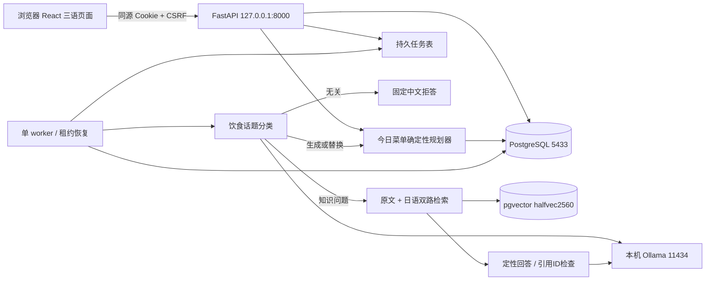

# 当前实现与数据口径

原drawio是目标架构，未覆盖本次全部简化；此图描述实际实现，不代表目标已全部完成。

## 应用表

| 表 | 内容 / 隔离 |
|---|---|
| app_users | ID1–50、唯一登录名、Argon2哈希、启用状态；无公开建号 |
| app_sessions | 随机会话token的SHA256、用户、CSRF、12小时到期 |
| app_profiles | 每用户JSON档案及乐观锁版本；收入档次JPY |
| app_bp | 每用户血压及带时区时间；只记录不诊断 |
| app_income_policies | 6档不重叠收入区间、版本、模拟默认预算 |
| app_ingredients | 官方食品复合外键(dataset_id,code)、三语名、过敏标签、模拟价格、状态 |
| app_recipes | 固定配料克数、允许份量、版本、图片及说明 |
| app_chat_sessions/messages | 所有权归属会话；后端按user_id检查 |
| app_jobs | 用户/幂等键唯一、持久状态、快照、租约、重试次数、结果 |
| app_recommendations | 历史方案JSON快照；后续档案变化不覆写 |
| app_home_cache | 每用户键包含东京日期、档案/规则/菜谱/价格/食品数值及策略 |
| app_migrations | 已执行SQL和哈希；不允许修改已应用迁移 |

食品源表、知识库表沿用已有数据。具体约束与字段见 `backend/migrations/001_application.sql` 和 `docs/API.openapi.json`。

## 数值与来源

营养值=官方每100g可食部数值×配方可食重量/100。熟米饭、烤肉鱼、煮菜使用所选食品条目的对应熟重，不以原料重量冒充；不自动推算采购重量。价格是JPY/100g已列明状态可食部，按同一重量线性计算。

参与展示的字段为能量kcal、蛋白质/脂肪/碳水/纤维g、钠/钾mg；食盐相当量展示由钠×2.54/1000换算。不同成分分析口径可能使三大营养素按4/9/4回算值不等于官方能量；不擅自覆盖官方值。

Tr、缺失和未解决标记保持原状，不能当0。日总量任何配料存在非数值项时，该项点估计显示不完整。钠Tr用0.5mg/100g显示上界，数值0用0.1mg/100g上界，其他数值按显示精度增加半单位；这些是表值精度控制，不是实际食物生物变异保证。相关说明来自食品PDF物理33–34页（印刷28–29），盐当量换算见物理30页（印刷25）。

已导入食品PDF缺营养主表。数值核对使用官方Excel工作表/行号/单元格；配料source保存PDF说明、索引和能量比较页，均明确不作为全套营养值核验页。食品01210仍排除。食谱详情可查看Excel单元格和关联PDF物理页。

JSON方案保存菜谱版本、实际配料克数、成分原值/状态/估算标记、配料版本/来源、价格、规则版本、档案版本及预算来源。金额比较使用未展示取整值。图片为本项目原创SVG示意图，非实拍照片。
